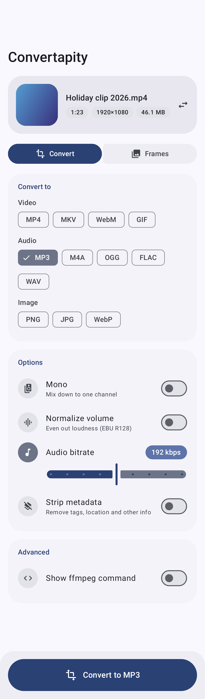
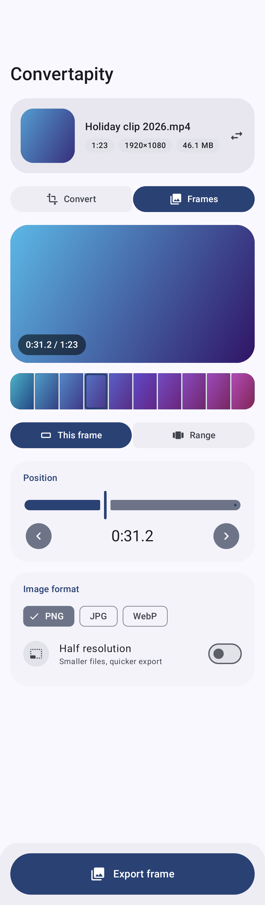
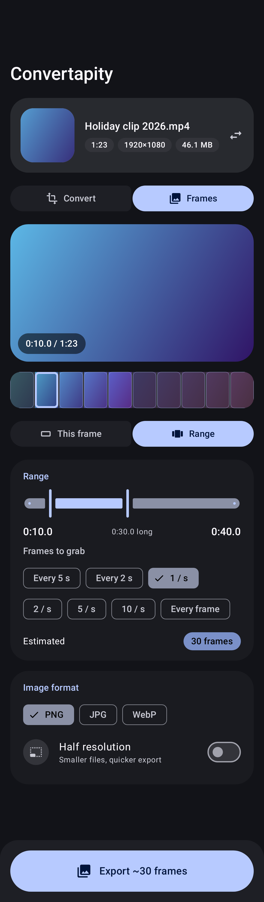

# Convertapity

A Material 3 Expressive Android app that converts media with FFmpeg and exports video frames.
Pick a file, choose a format, flip the toggles, tap Convert.

<p>
  
  
  
</p>

## Features

**Convert**

| Output | Formats | Options |
|---|---|---|
| Video | MP4, MKV, WebM | include audio track, include video track, fast copy (no re-encode), limit resolution, quality, audio bitrate, mono, normalize volume |
| Audio | MP3, M4A (AAC), OGG, FLAC, WAV | bitrate, mono, normalize volume |
| GIF | GIF (palette-optimized) | fps, width, loop |
| Image | PNG, JPG, WebP | |
| All | | strip metadata, show the exact ffmpeg command |

Only the formats and options that make sense for the picked file are shown.

**Frames** (videos)

- Live preview with a scrubber, 0.1 s stepping and a tappable filmstrip
- Export the current frame, or a range (every 5 s, every 2 s, 1-10 per second, or every frame)
  into a new folder you choose
- PNG, JPG or WebP, optional half resolution

**Feel**: Material You dynamic color, light/dark themes, an adaptive icon with Android 13 themed-icon
support, spring animations and haptics throughout, wavy progress, and a snackbar to open the result.

## Getting the APK

Every push runs the **Build & release v1** GitHub Actions workflow (`.github/workflows/build.yml`).
It builds the APK and publishes it to the **v1** release of this repo, together with `ffmpeg-arm64.zip`.

1. Open the repo's **Releases** page, download `Convertapity-v1.apk` on your phone and install it.
2. Open the app and tap **Download ffmpeg** once (about 40 MB). After that it works offline.

Needs a 64-bit ARM phone (nearly every modern Android phone).

## Building locally

Needs JDK 17 and Android SDK 36.

```
./gradlew assembleRelease
```

APK: `app/build/outputs/apk/release/app-release.apk`

## Notes

- The release APK is signed with the keystore committed at `app/release.jks` (password `convertapity`), so updates install over older builds. It is not a secret; use your own keystore if you distribute this widely.
- The app targets SDK 28 on purpose. Android 10+ stops apps targeting 29+ from running a downloaded
  binary, and this app runs ffmpeg as one. That's fine for installing the APK yourself, but it
  rules out Google Play.
- ffmpeg is Termux's Android build (GPL), packaged with its shared libraries by
  `scripts/package_ffmpeg.py` and attached to the v1 release by the workflow.

## Layout

- `CommandBuilder.kt` builds the ffmpeg arguments (conversion, single frame, frame range)
- `MediaInfo.kt` reads file metadata and preview frames
- `AppViewModel.kt` holds the screen state
- `FfmpegManager.kt` downloads, unpacks and checks ffmpeg
- `Converter.kt` runs ffmpeg, reports progress, writes the result to the file you pick
- `ui/` the Compose UI: `AppScreen.kt`, `ConvertPane.kt`, `FramesPane.kt`, `Components.kt`, `Theme.kt`

## Screenshots without a device

`./gradlew testDebugUnitTest` renders the main screens with Robolectric + Roborazzi into
`app/build/screenshots/`.
